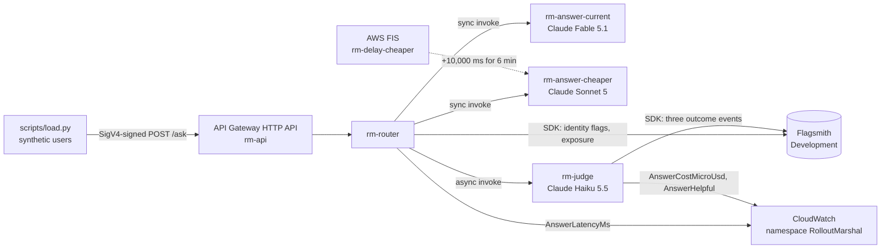
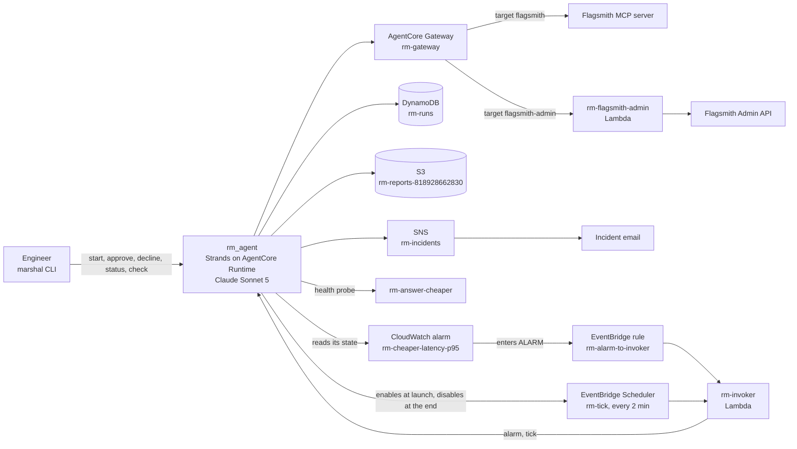
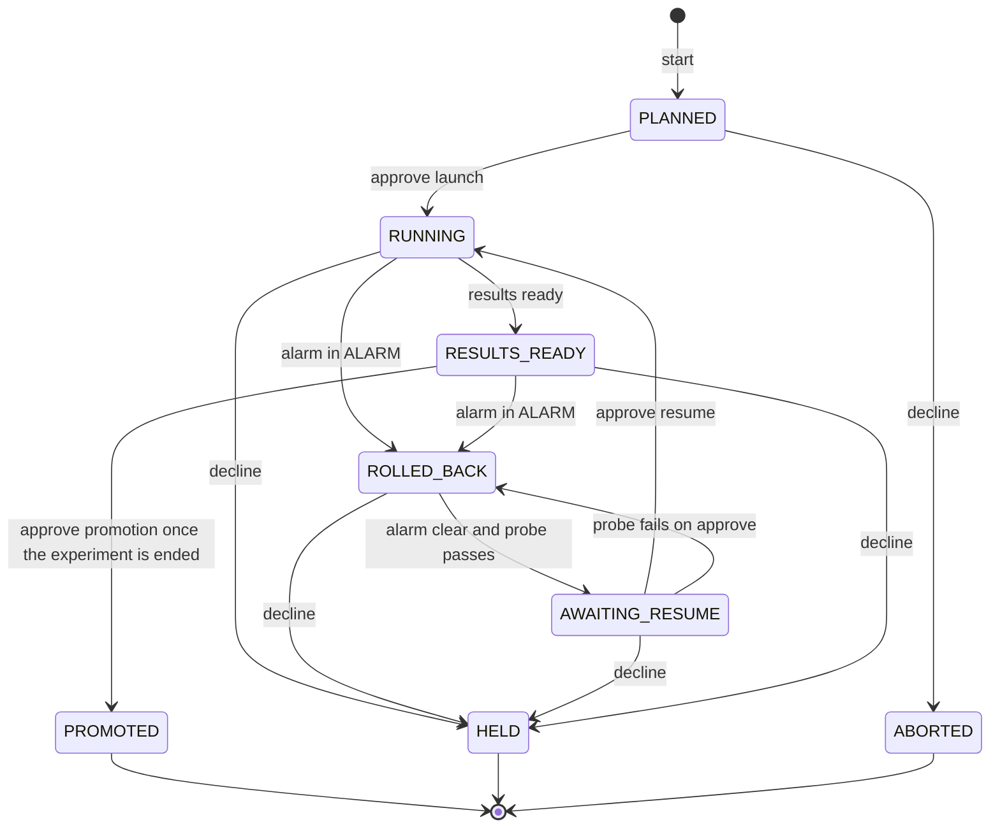

<!-- Draft (task 6.2). The one remaining placeholder, [[6.4: video URL]], is Ahmed's, after he
records. Delete this comment once it is filled. -->

# Rollout Marshal

An agent that runs a Bedrock model migration experiment end to end with Flagsmith, with a
human approving each risky step.

An engineer gives it one prompt. It plans the test, sets it up in Flagsmith, watches it on
AWS, rolls back on trouble, and asks a human before resuming or promoting.

Built by team Built Not Theorized for the Toggle Wars hackathon (Flagsmith and WeMakeDevs),
Track 2, "AI Agents and Feature Flags". Demo video: [[6.4: video URL]].

## The numbers

From one dashboard pass and the two full runs, all on 2026-11-27:

| Setting up the experiment | Time |
| --- | --- |
| In the Flagsmith dashboard, clicked through in Chrome by an AI agent (the one that led this build) at Ahmed's instruction, not by a person. One metric attached | about 2:18 |
| Rollout Marshal's own work, planning then launching, all three metrics attached: second full run, `r202611272042` | about 0:39 |
| The same, first full run, `r202611271927` | about 1:20 |

| Run | The plan waiting for the engineer's approval | `marshal start` to `RUNNING`, in all |
| --- | --- | --- |
| `r202611271927` | 12:33 | 13:53 |
| `r202611272042` | 6:43 | 7:22 |

- **The dashboard pass** was done by an agent because Ahmed told the lead agent to do it,
  where the task asked for a person. So it includes that agent's own time between actions,
  and a person might be faster or slower. The dashboard's experiment form took only the
  primary metric.
- **Rollout Marshal's own work** is 6.6 s to plan and 32.7 s to launch in the second run. In
  the first it was 7.6 s and 72.9 s: its first experiment start failed, and the next tick
  retried it.
- **The wait for approval** is the human's time, not the agent's.

How each was measured, and what neither number counts: [docs/time-saved.md](docs/time-saved.md).

## The problem

Moving a production assistant to a cheaper model is a real cost decision that teams make by
hand today: set up flags, wire metrics, watch dashboards, decide in a meeting.

The move tested here takes a support assistant from Claude Fable 5.1 to Claude Sonnet 5 on
Amazon Bedrock. Per token, Claude Sonnet 5's list price in us-east-1 is a fifth of Claude
Fable 5.1's, for input and for output (`app/prices.json`, copied from the Bedrock pricing
page's price files on 2026-11-27, `evidence/3.3-prices.md`). The question is whether its
answers stay as helpful, and as fast.

Testing that safely takes a new flag and a new experiment for every run, metrics wired to
each answer's outcome, someone watching latency the whole time, a fast rollback when the
cheaper model misbehaves, and a decision at the end that someone can defend. Rollout Marshal
runs that loop from one prompt. It asks a person before every step that changes what users
get, except the rollback, which it does at once.

## What a run looks like

1. **The ask.** The engineer runs `marshal start "Test moving the support assistant from
   Claude Fable 5.1 to Claude Sonnet 5. Don't let answer quality or latency slip."` The
   agent returns a plan: a hypothesis, the primary metric, guardrails, a 50/50 split and
   stop rules. Nothing exists in Flagsmith for the run yet.
2. **Approve the launch.** `marshal approve <run_id> launch`. The agent creates the run's
   feature, its `cheaper` option, the metrics and the experiment in Flagsmith, and starts it.
3. **Traffic.** `scripts/load.py` sends 150 synthetic users, 10 questions each, to the
   assistant API. Each user is served the model Flagsmith assigns it.
4. **A failure.** `scripts/inject_fault.sh` makes every answer from the cheaper model 10
   seconds slower, for 6 minutes. The p95 latency alarm on the cheaper arm fires.
5. **Automatic rollback.** Without asking anyone, the agent turns the kill switch
   `assistant_cheaper_enabled` off, so every user gets the current model, and emails an
   incident note.
6. **Resume, with a human.** Once the alarm has cleared and a health probe of 5 calls
   passes, the agent emails a resume request. `marshal approve <run_id> resume` checks
   again and turns the kill switch back on.
7. **The report.** When each arm has at least 50 users and Flagsmith's results are in, the
   agent writes a report to S3 and emails it, with a recommendation made by fixed rules.
8. **The decision.** To promote, the engineer ends the experiment in the Flagsmith dashboard,
   then runs `marshal approve <run_id> promotion`, which sets `assistant_default_model` to
   `cheaper` for everyone. To hold: `marshal decline <run_id>`.

## The three approval points

| Command | The agent asks for it | What happens on approve |
| --- | --- | --- |
| `marshal approve <run_id> launch` | after `marshal start`, while the run is `PLANNED` | It creates the experiment in Flagsmith and starts it |
| `marshal approve <run_id> resume` | after a rollback, once the alarm is out of ALARM and the probe has passed: the run is `AWAITING_RESUME` | It checks the alarm and probes again, then turns the kill switch back on. If the probe fails, the run goes back to `ROLLED_BACK` |
| `marshal approve <run_id> promotion` | after the report, while the run is `RESULTS_READY` | Only once the engineer has ended the experiment in Flagsmith: it sets `assistant_default_model` to `cheaper`. If the alarm is in ALARM, it rolls back instead |

- An approve names the step it approves. If the run now waits for something else (an alarm
  moved it, say), the approve is refused with `ILLEGAL_IN_STATE` and nothing changes.
- `marshal decline <run_id>` stops a run at any point before it ends: `ABORTED` before the
  launch, `HELD` after it.
- The one change to live traffic the agent makes alone is the rollback, which moves every
  user to the current model.
- `marshal status [run_id]` shows a run. `marshal check <run_id>` does now what the alarm or
  the next tick would do, the manual fallback if the alarm path breaks.

## The two full runs

Both ran on 2026-11-27 and ended `HELD`, each with the history `PLANNED`, `RUNNING`,
`ROLLED_BACK`, `AWAITING_RESUME`, `RUNNING`, `RESULTS_READY`, `HELD`. No code changed between
them. The records are `evidence/5.1-e2e.md` and `evidence/5.2/r202611272042.md`.

| | First, `r202611271927` | Second, `r202611272042` |
| --- | --- | --- |
| `marshal start` | 19:26:55Z | 20:42:29Z |
| The plan returned | 7.6 s later | 6.6 s later |
| The plan waiting for Ahmed's launch approval | 12 min 33 s | 6 min 43 s |
| `RUNNING`, after the approval | 72.9 s: the first experiment start timed out, and the next tick finished the launch | 32.7 s |
| The fault started | 19:40:50Z | 20:49:52Z |
| Rolled back, with no human | 19:44:43Z, 3 min 53 s into the fault | 20:54:15Z, 4 min 22.6 s into the fault: the alarm's invocation claimed it by 20:53:24Z, and the next tick finished it |
| The resume request | 29 min 36 s after the rollback, held back by a probe bug fixed mid-run (below) | 7 min 45 s after the rollback |
| Ahmed approved the resume | 20:32:52Z | 21:03:00Z |
| Results ready: the report written to S3 and published | 20:34:39Z | 21:04:20Z |
| Ahmed declined: `HELD` | 20:35:20Z | 21:05:06Z |
| The load | 1,500 sent, 1,498 answered | 1,500 sent, 1,500 answered |
| `scripts/e2e.py` | drove it to `ROLLED_BACK`; the lead finished it with `marshal status` reads | drove it from `start` to `HELD`, and exited 0 |

The reports:

| Run | Arm | Identities | `helpful_rate` | `mean_latency_ms` | `mean_cost_micro_usd` |
| --- | --- | --- | --- | --- | --- |
| `r202611271927` | current | 76 | 0.996053 | 5519.33 | 13498.3 |
| | cheaper | 74 | 0.997297 | 6361.33 | 11284.7 |
| `r202611272042` | current | 81 | 0.99369 | 5456.23 | 13561.9 |
| | cheaper | 69 | 0.997101 | 6297.08 | 9887.46 |

- **Recommendation: `hold, re-run`**, both times, because each run had an incident.
- **Latency guardrail: failed** both times. The cheaper arm's latency was 115 percent of the
  current arm's, over the 110 percent limit. The fault drove it.
- **Cost guardrail: passed, but biased.** Rolled-back users count in the cheaper arm although
  they were served the current model. So its mean cost, 11284.7 and 9887.46 micro-USD, is
  far above the roughly 2,700 per answer that Claude Sonnet 5's answers alone averaged in
  task 3.6.
- **Helpfulness is at its ceiling.** `helpful_rate` is near 1 in both arms of both runs, so
  its interval (lower bound -0.0045 both times) is not evidence that the two models are
  equally helpful.
- **Flagsmith's dashboard pointed the other way**, both times.
  - Its experiment page read "66% Winner Probability Confirmed" in the first run and "80%
    Winner Probability Confirmed" in the second, each with "Consider rolling out cheaper to
    all users".
  - Its "Complete experiment" dialog pre-selected "Roll out a variant: cheaper".
  - Rollout Marshal's report said `hold, re-run`, because the run had an incident; the
    latency guardrail had failed too, while the fault ran. Ahmed held each run, and each
    experiment was ended with "Roll out control" to match.
- **Who did what.** Ahmed typed every `marshal approve` and `marshal decline`. In the first
  run, Claude Code's auto mode refused the lead agent's own attempt to approve. The lead
  agent ended experiments 1495 and 1503 in the dashboard, under Ahmed's delegation.
- **What the first run found.**
  - The agent's OpenTelemetry instrumentation added a `headers` field to the health probe's
    request, which `answer_request` refuses. So every probe failed, and the run could not
    reach the resume request until the fix (PR #38) was deployed mid-run. The second run
    used the fixed runtime, and its probe passed on the first tick.
  - Three earlier starts never launched: two approval windows ran out, then an SSO session
    expired.

## Architecture

Everything on AWS runs in one account, in us-east-1. Flagsmith is the SaaS, project
"Toggle Wars", environment "Development".

### The system under test



For each answer, `rm-router`:

1. reads the active run's pointer from DynamoDB `rm-runs`, cached for 30 seconds;
2. makes one Flagsmith identity request, `get_identity_flags`, whose result carries both the
   run's experiment feature and the kill switch;
3. records the exposure, for an identity in the experiment;
4. serves `current` when the kill switch is off, and the assigned model otherwise;
5. times the answer invoke, so an injected delay shows in `AnswerLatencyMs`;
6. hands the answer to `rm-judge`, off the request path.

`rm-judge` asks Claude Haiku 5.5 whether the answer is helpful, computes its cost from the
token counts and `app/prices.json`, writes both to CloudWatch, then sends three events to
Flagsmith for the same identity: `answer_helpful` (1 or 0), `answer_latency_ms` and
`answer_cost_micro_usd`.

With no active run, the router serves the model `assistant_default_model` names, and records
no exposure and no event.

### The agent and its signals



- `rm_agent` is a Strands agent on Amazon Bedrock AgentCore Runtime, deployed as
  `rm_default_rm_agent`. Each invocation is short and stateless; the run lives in DynamoDB
  `rm-runs`.
- Three things wake it: the `marshal` CLI; `rm-invoker` when the alarm enters ALARM; and
  `rm-invoker` again every 2 minutes on the `rm-tick` schedule, which runs only from the
  launch to the end of the run.
- The alarm is the p95 of `AnswerLatencyMs` for `Variant=cheaper`, over 60-second periods,
  2 of 2 above a threshold of 10000 ms. Task 4.1 set it from task 3.6's baseline p95 for the
  cheaper arm, 4772.8 ms, plus half the injected delay, rounded up to the next 1000
  (design.md section 5).
- Its model, Claude Sonnet 5, does three things only: it turns the prompt into a plan,
  writes the incident note and writes the report's prose. State changes, stop rules and the
  recommendation are deterministic code.
- Each transition is a guard, a claim, its effects and a commit on the run's item, so it
  happens at most once, even when an alarm and a tick arrive together. If an effect fails,
  the next tick or `marshal check` finishes the same transition.
- The infrastructure is Terraform in `infra/`, except the agent runtime, which the AgentCore
  CLI deploys, and the Gateway pieces, which `agent/scripts/setup_gateway.py` creates.

### A run's states



## How Flagsmith is used

| Part of Flagsmith | Used by | For |
| --- | --- | --- |
| **MCP server**, `https://mcp.flagsmith.com`, through AgentCore Gateway target `flagsmith`, with the organisation API key | the agent | Creating the run's multivariate feature `assistant_model_<run_id>` (value `current`) and its option (key and value `cheaper`); creating the experiment with its whole rollout block (100 percent of identities, `cheaper` at 50 percent); turning the kill switch `assistant_cheaper_enabled` off and on, and setting `assistant_default_model` on promotion, each through a v2 feature version (create it, update its state, publish it) |
| **Admin API**, `https://api.flagsmith.com`, through Lambda `rm-flagsmith-admin` (Gateway target `flagsmith-admin`) | the agent | Getting or creating the three metrics; starting the experiment; refreshing and reading its results; reading its status, to check it has ended before a promotion |
| **Admin API**, directly | `scripts/bootstrap_flagsmith.py`, `scripts/seed_experiment.py`, `scripts/reset.py` | Creating the two permanent features; seeding a test run without the agent; putting things back between runs |
| **Python SDK**, `flagsmith` 6.6.0 or later, remote evaluation, events on | `rm-router` and `rm-judge` | One `get_identity_flags` per answer; `track_exposure_event` for each identity in the experiment; three outcome events per answer through `track_event`; `flush_events()` before every return |
| **Experimentation** | the experiment, and the engineer in the dashboard | The 50/50 split; three metrics, `helpful_rate` attached first as the primary and `mean_latency_ms` and `mean_cost_micro_usd` as guardrails; results per arm, with the lift and its 95 percent credible interval; the engineer ends the experiment in the dashboard |

- **Why both MCP and the Admin API.** The MCP server cannot create a metric (its
  `create_metric` drops the required definition), start an experiment or refresh results
  (task 1.3, `evidence/1.3-flagsmith-agent-spike.md`). Those go through the Admin API.
- **The join.** The judge's outcome events, sent from a second SDK client in another
  invocation, join the router's exposures per identity. Task 1.2 showed it on a spike
  experiment (design.md section 13).
- **The budget.** One identity request per answer, against the Free plan's 50,000 API
  requests a month.
- **What the agent never does in Flagsmith**: end, pause or roll out an experiment, or change
  an experiment's feature while it runs. At the tool boundary, its MCP allow-list leaves out
  `update_experiment` and every delete tool, an experiment create that carries a status field
  is refused, and its Admin API path builder cannot produce `complete/`, `pause/` or
  `rollout/`. The engineer ends every experiment in the dashboard.
- **The primary metric.** The API has no primary-metric field, so the agent attaches
  `helpful_rate` first. In both full runs the dashboard showed `helpful_rate`, "should not
  decrease", as primary.

## How the decision is made

- **The metrics.** The primary metric is `helpful_rate`, the mean of `answer_helpful` (1 or
  0). The guardrails: the cheaper arm's `mean_latency_ms` is at most 110 percent of the
  current arm's, and its `mean_cost_micro_usd` is no higher.
- **When results count.** They are ready when both arms have at least 50 identities and all
  three metrics have values. They are not read in the first 600 seconds after the launch, so
  a fast-filling experiment cannot finish before a fault can show.
- **The rule, in code:**
  - any incident during the run: `hold, re-run`;
  - otherwise `promote`, only if the lower bound of Flagsmith's 95 percent credible interval
    for the lift on `helpful_rate` is at or above minus 5 percent and both guardrails pass.
    That is at least a 97.5 percent probability that the lift is at least minus 5 percent;
  - otherwise `hold`.
- **What to expect.** No run has recommended `promote`. Every planned run injects the fault,
  so the rule says `hold, re-run` after each one, as it did in both full runs. The `promote`
  branch is covered by unit tests.
- **Promotion still needs a person.** Whatever the report recommends, promotion waits for the
  engineer to end the experiment in Flagsmith and approve.

The runs recorded for this entry, each with its history in `evidence/5.1-e2e.md` or
`evidence/5.2/`:

| Run | Final state | Recommendation, as its report states it | Report |
| --- | --- | --- | --- |
| `r202611271927` | `HELD` | `hold, re-run` | `runs/r202611271927/report.md` |
| `r202611272042` | `HELD` | `hold, re-run` | `runs/r202611272042/report.md` |

Each report is at `s3://rm-reports-818928662830/runs/<run_id>/report.md`, with nine sections:
Hypothesis, Setup, Timeline, Results, Guardrails, Incident, Known bias, Recommendation and Time
taken.

## What is simulated

1. **The users.** 150 synthetic identities per run, `<run_id>-user-001` to
   `<run_id>-user-150`, new to Flagsmith on every run. `scripts/load.py` sends them from the
   engineer's shell: 10 questions each in a full run, 1,500 answers, at most 10 at a time.
   The questions are 30 support questions about a fictional SaaS product
   (`app/questions.json`). No real user is involved.
2. **The failure.** AWS Fault Injection Service adds 10,000 ms to every invocation of
   `rm-answer-cheaper` for 6 minutes (template `rm-delay-cheaper`). `scripts/inject_fault.sh`
   starts it on purpose, and it ends by itself. Its slow answers stay in the cheaper arm's
   `mean_latency_ms`.
3. **Helpfulness.** A model scores it, not a person: Claude Haiku 5.5 grades each answer
   helpful or not, so neither arm grades itself. A reply that is not `{"helpful": true}` or
   `{"helpful": false}` counts as not helpful.
4. **Cost.** Computed, not billed: each answer's input and output tokens times the list prices
   in `app/prices.json`.
5. **The rollback, and its bias.** Every planned run injects the fault and so rolls back.
   Its results then carry the two biases below, which is why the rule says `hold, re-run`
   after an incident.

## Known biases

Each report names both (design.md section 10):

1. **Rolled-back users still count in the cheaper arm.** While `assistant_cheaper_enabled` is
   off, users assigned `cheaper` are served the current model, but their outcomes count as
   the cheaper arm's.
2. **An identity first seen while `assistant_cheaper_enabled` is off is enrolled in `cheaper`
   without being served it**, when Flagsmith assigns it `cheaper`: the router serves `current`
   while the kill switch is off.

## Set it up

### What you need

- **AWS.** An account with Bedrock access, in us-east-1, to `us.anthropic.claude-fable-5-1`,
  `us.anthropic.claude-sonnet-5` and `us.anthropic.claude-haiku-5-5`. Claude Fable 5.1 needs
  the account's Bedrock data retention mode set to `aws_review` in us-east-1. At least 50
  Lambda concurrent executions.
- **Flagsmith.** A project with an environment whose managed warehouse is connected
  (Environment Settings, Warehouse) and that uses v2 feature versioning, as the code assumes.
  An organisation API key, and the environment's client-side SDK key from its SDK Keys page.
  This project runs on the Free plan (50,000 API requests a month).
- **Tools.** Python 3.13 and uv; Terraform 1.10 or later; the AWS CLI; Node.js and the
  AgentCore CLI (`npm install -g @aws/agentcore`, 1.3.0 or later within 1.x); jq.
  `make preflight` checks Terraform, uv, Node.js, jq and the AgentCore CLI, and runs its other
  checks through the AWS CLI.

### The IDs this repo pins

It was built for one AWS account and one Flagsmith project. Its account checks refuse any
other AWS account:

- AWS account `818928662830`, region us-east-1. `git grep 818928662830` lists every file that
  names it, among them the Terraform provider's `allowed_account_ids` (`infra/main.tf`), the
  state bucket (`infra/backend.tf`) and `contracts/names.py`.
- Flagsmith organisation `41656`, project `55601`, environment "Development", in
  `contracts/names.py`.

To run it in another account or project, change each of those first. That has not been tried.

### 1. Install and test

```
git clone https://github.com/abebars/rollout-marshal
cd rollout-marshal
make install   # uv sync: Python 3.13 and every dependency group
make test      # the unit tests; tests marked live, which call AWS and Flagsmith, are left out
```

### 2. Secrets

Two secrets in Secrets Manager, in us-east-1. Pasting each value at the prompt keeps it out
of shell history:

```
read -s V && aws secretsmanager create-secret --region us-east-1 \
  --name rm/flagsmith/api-key --secret-string "$V"; unset V
read -s V && aws secretsmanager create-secret --region us-east-1 \
  --name rm/flagsmith/server-key --secret-string "$V"; unset V
```

The first holds the organisation API key; the second, the environment's client-side SDK key.
Each reader fetches its value at run time, and nothing prints it.

### 3. Preflight

```
make preflight
```

It prints one `ok` or `FAIL` line per check: the account; the Bedrock data retention mode,
which it sets to `aws_review` if it is anything else; both secrets, by their metadata only;
one Bedrock Converse call per model; the AgentCore and FIS APIs; Lambda concurrency; and the
tools. Its `gh` line checks push rights on this repository, which a stranger will not have.

### 4. Deploy

In this order, since each step needs the one before it:

1. **The Terraform state bucket** that `infra/backend.tf` names. Locking uses an S3 lock
   file, so no lock table is needed.
2. **The agent runtime.**

   ```
   uv run python agent/scripts/deploy_agent.py --plan --record <file>   # reads only
   uv run python agent/scripts/deploy_agent.py --record <file>          # deploys
   ```

   The script wraps the AgentCore CLI's deploy, which deploys `rm_agent` as
   `rm_default_rm_agent` through its own CDK stack, `AgentCore-rm-default`, and bootstraps CDK
   on the first deploy. It then writes the runtime's ARN to SSM parameter
   `/rm/agent-runtime-arn`, where the CLI and `rm-invoker` read it. On its first deploy here,
   the CLI also turned on CloudWatch Transaction Search for the whole account
   (`evidence/1.3-flagsmith-agent-spike.md`, step 2).
3. **Everything else on AWS**, with Terraform. Copy `infra/terraform.tfvars.example` to the
   git-ignored `infra/terraform.tfvars`, and set `incident_email` to your address and
   `invoker_stub = false`. With `true`, `rm-invoker` only logs what it would send. Then:

   ```
   make build
   terraform -chdir=infra init
   terraform -chdir=infra plan
   terraform -chdir=infra apply
   ```

4. **The Gateway**: its credential provider, its service role, the Gateway and its two
   targets.

   ```
   uv run python agent/scripts/setup_gateway.py --plan   # reads only
   uv run python agent/scripts/setup_gateway.py
   ```

5. **Flagsmith's two permanent features**, `assistant_cheaper_enabled` (the kill switch) and
   `assistant_default_model` (`current` until a promotion):

   ```
   uv run python scripts/bootstrap_flagsmith.py
   ```

6. **The email subscription.** Confirm it from the message SNS sends to `incident_email`.
7. **The check.** `uv run marshal status` prints a message that starts "no active run".

This order follows design.md sections 2 and 7. Nobody has run it in one go from an empty
account. In this project the steps ran across several tasks: the runtime first in task 1.3,
then Terraform, the Gateway and a redeploy in task 2.7 (`evidence/2.7-agent-deploy.md`).

### 5. Run an experiment

From the repository root, with AWS credentials for the account:

```
uv run marshal start "Test moving the support assistant from Claude Fable 5.1 to Claude Sonnet 5. Don't let answer quality or latency slip."
uv run marshal approve <run_id> launch

# Keep the URL out of logs and evidence: never echo it
ASK_URL=$(terraform -chdir=infra output -raw ask_url)
# The load runs until it has sent all 1,500 requests; run the rest from a second shell
uv run python scripts/load.py --run-id <run_id> --users 150 --questions 10 --url "$ASK_URL"

# Second shell, straight after the load starts
scripts/inject_fault.sh
uv run marshal status <run_id>            # ROLLED_BACK a few minutes in; the incident note goes out by email
uv run marshal approve <run_id> resume    # after the "ready to resume" email

# After the "results ready" email, which carries the report: either hold
uv run marshal decline <run_id>
# or end the experiment in the Flagsmith dashboard, then promote
uv run marshal approve <run_id> promotion

uv run python scripts/reset.py            # back to the resting state before the next run
```

- `marshal start` prints the run's ID on its `run:` line. Every `marshal` command exits 0
  when the response has no error, 1 when it carries an error code, and 2 on a usage error.
- `scripts/e2e.py` drives the same run, prints UTC timestamps and pauses for the engineer at
  each approval; it never approves anything itself. Both full runs ran it as
  `uv run python scripts/e2e.py --pause-minutes 180 --record <new file>.json` (PR #37).
- `scripts/inject_fault.sh` needs credentials that may start AWS FIS experiments. The fault
  ends by itself.
- `scripts/reset.py` refuses while a run is still active, unless given `--force`, and lists
  any experiment still running for the engineer to end in the dashboard.
- Each answer cost 13,531.3 micro-USD on Claude Fable 5.1 and 2,708.5 on Claude Sonnet 5, on
  average (US$0.0135 and US$0.0027). These are CloudWatch's means of `AnswerCostMicroUsd`
  over every judged answer of the build, read after the last run
  (`evidence/5.2/r202611272042.md`). Over the whole build it sums to 40,812,020 micro-USD
  (US$40.81), for 3,601 answers sent. Judging and the agent's own calls come on top.

## Safety rails

- No launch, resume or promotion without the engineer's `approve`, and each approve names its
  step.
- The rollback is the only change to live traffic the agent makes alone.
- No agent ends an experiment. The engineer ends every one in the Flagsmith dashboard, and
  promotion waits for that.
- One run at a time: `marshal start` is refused with `RUN_ACTIVE` while a run is active.
- Each transition happens at most once, even when an alarm and a tick arrive together.
- The model writes words only: the plan's hypothesis and summary, the incident note and the
  report's prose. Decisions are code.
- Secrets stay in Secrets Manager and AgentCore Identity. They are read at run time and never
  printed.
- The load is bounded: `scripts/load.py` stops at its count, refuses to start while another
  load runs, and signs every request; the API accepts only IAM-signed requests.

## Repository layout

| Path | Holds |
| --- | --- |
| `agent/` | the agent (`agent/runtime/rm_agent/`), the `rm-flagsmith-admin` function (`agent/flagsmith_admin/`), the Gateway setup script and the AgentCore CLI project |
| `cli/` | the `marshal` command line |
| `app/` | the router, the answer and judge functions, the questions and the prices |
| `signals/` | `rm-invoker` |
| `infra/` | Terraform: the root, and the modules `app`, `agent`, `signals` and `fis` |
| `scripts/` | load, fault, bootstrap, seed, reset and preflight |
| `contracts/` | every shared name (`names.py`) and the JSON schemas |
| `openspec/changes/build-rollout-marshal/` | the proposal, the design (the contract every name comes from), the specs and the task board |
| `evidence/` | what each task ran, with its commands and their output |
| `docs/` | time saved, the video script and the review protocol |

## More

- How the times were measured: [docs/time-saved.md](docs/time-saved.md)
- The demo video's script: [docs/video-script.md](docs/video-script.md)
- The contract: [design.md](openspec/changes/build-rollout-marshal/design.md)
- The runs: `evidence/5.1-e2e.md` and `evidence/5.2/`
