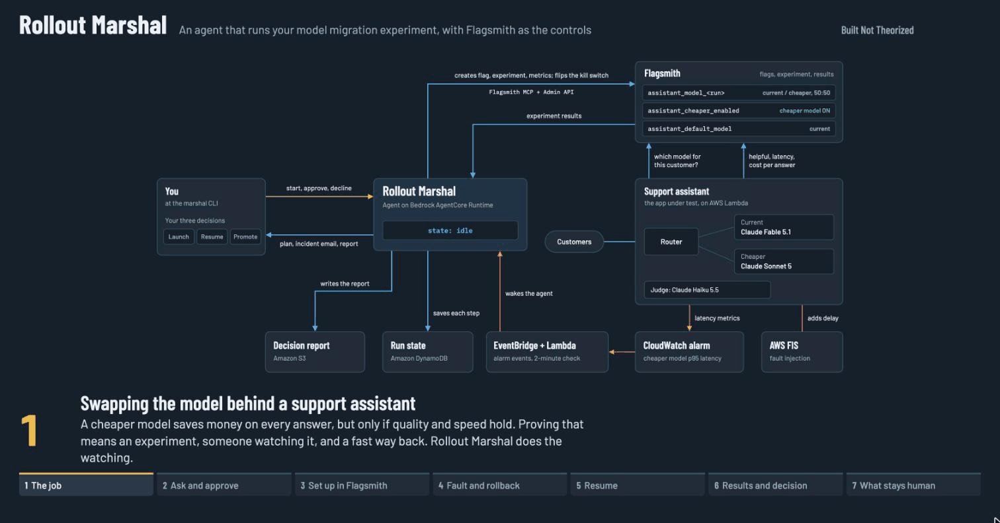

<!-- Draft (task 6.2). The one remaining placeholder, [[6.4: video URL]], is Ahmed's, after he
records. Delete this comment once it is filled. -->

# Rollout Marshal

**An AI agent that runs a Bedrock model migration as a Flagsmith experiment from one prompt,
rolls back on its own, and asks a human before every other change.**



*A run in seven steps. To step through it with the arrow keys, download
[docs/assets/walkthrough.html](docs/assets/walkthrough.html) and open it in a browser. Demo video: [[6.4: video URL]].*

## What it does

A cheaper model saves money on every answer, but only if quality and speed hold. Proving it takes
a flag, an experiment, metrics, someone watching latency and a fast way back. Rollout Marshal runs
that loop, here for a support assistant moving from Claude Fable 5.1 to Claude Sonnet 5.

- **Plans from one prompt.** `marshal start` turns a plain request into a hypothesis, a primary
  metric, guardrails, a 50/50 split and stop rules. Nothing launches until you approve.
- **Launches in Flagsmith.** It creates the run's flag, variation and experiment, with three metrics.
- **Rolls back on its own.** When the cheaper arm's p95 latency alarm fires, it turns a kill switch
  off, so every user gets the current model, and emails an incident note.
- **Resumes only on approval.** Once the alarm clears and a health probe passes, it asks first.
- **Reports, and you decide.** Fixed rules make its recommendation; promotion waits for you to end
  the experiment in Flagsmith and approve.

## How it works

1. **The job:** move the support assistant to the cheaper model without losing quality or speed.
2. **Ask and approve:** `marshal start` turns one sentence into a plan; nothing launches until you approve.
3. **Set up in Flagsmith:** the agent creates the flag, the 50/50 split, three metrics and the experiment.
4. **Fault and rollback:** AWS FIS slows the cheaper model, the alarm fires, the agent turns the kill switch off.
5. **Resume:** once the alarm clears, the agent asks, and your approve turns the cheaper model back on.
6. **Results and decision:** the agent writes a report from Flagsmith's results; promotion needs your approve.
7. **What stays human:** launch, resume and promotion, and ending the experiment. The agent does the rest.

### Architecture at a glance

| Component | What it is for |
| --- | --- |
| **`rm_agent`**, a Strands agent on Amazon Bedrock AgentCore Runtime | Runs the experiment. Its model, Claude Sonnet 5, turns the prompt into a plan and writes the incident note and the report's prose; state changes and the recommendation are code |
| **The support assistant**: API Gateway `rm-api`, Lambda `rm-router`, `rm-answer-current`, `rm-answer-cheaper` and `rm-judge` | The app under test. The router asks Flagsmith which model each user gets; the judge has Claude Haiku 5.5 score each answer, and computes its cost from tokens and list prices |
| **Flagsmith MCP server**, through AgentCore Gateway `rm-gateway` | The run's feature, its option and the experiment; the kill switch `assistant_cheaper_enabled` and `assistant_default_model` |
| **Flagsmith Admin API**, through Lambda `rm-flagsmith-admin` | The three metrics, the experiment's start, its results and its status |
| **Flagsmith Python SDK**, in `rm-router` and `rm-judge` | Per answer: one identity request, one exposure and three outcome events |
| **Flagsmith Experimentation** | The 50/50 split, the metrics, and results per arm with a 95 percent credible interval |
| **DynamoDB** `rm-runs` | Each run's state and history |
| **S3** `rm-reports-818928662830` | The decision reports |
| **SNS** `rm-incidents` | The emails: rolled back, ready to resume, results ready |
| **CloudWatch alarm** `rm-cheaper-latency-p95` | Fires when the cheaper arm's p95 latency is above 10,000 ms for two one-minute periods |
| **EventBridge** rule `rm-alarm-to-invoker` and schedule `rm-tick`, with Lambda `rm-invoker` | Wake the agent when the alarm fires, and every 2 minutes while a run is live |
| **AWS FIS** template `rm-delay-cheaper` | The injected fault: 10,000 ms more on every cheaper answer, for 6 minutes |

The full diagrams are in [docs/how-it-works.md](docs/how-it-works.md#architecture).

## Requirements and integrations

- **AWS:** account `818928662830` in `us-east-1`, which the repo pins; its account checks refuse
  any other (to use yours, [change the pinned IDs](docs/how-it-works.md#the-ids-this-repo-pins)).
  Amazon Bedrock AgentCore Runtime, Gateway and Identity, and at least 50 Lambda concurrent executions.
- **Bedrock models:** `us.anthropic.claude-fable-5-1` (the current arm), `us.anthropic.claude-sonnet-5`
  (the cheaper arm and the agent's own model) and `us.anthropic.claude-haiku-5-5` (the judge).
  Claude Fable 5.1 needs the account's Bedrock data retention mode at `aws_review`.
- **Created for you:** the runtime by the AgentCore CLI, the Gateway by `agent/scripts/setup_gateway.py`,
  and the rest by Terraform: API Gateway, Lambda, DynamoDB, S3, SNS, CloudWatch, EventBridge, FIS, IAM.
- **Flagsmith:** a project with an environment named "Development", on v2 feature versioning, with
  Experimentation's managed warehouse connected (Environment Settings, Warehouse). The repo pins
  organisation `41656` and project `55601`. This build ran on the Free plan, 50,000 API requests a month.
- **Flagsmith keys, in Secrets Manager:** the organisation API key, as `rm/flagsmith/api-key`, and
  the environment's client-side SDK key, as `rm/flagsmith/server-key`. No server-side key is needed.
- **Tools:** Python 3.13 with uv; Terraform 1.10 or later; the AWS CLI; Node.js with the AgentCore
  CLI (`npm install -g @aws/agentcore@1`, 1.3.0 or later within 1.x); jq. gh is optional: only
  preflight uses it, to check push rights on this repo, and that check does not block the deploy.

## Install

```sh
git clone https://github.com/abebars/rollout-marshal
cd rollout-marshal
make install   # uv sync: .venv with Python 3.13 and every dependency group
make test      # the unit tests; tests marked live, which call AWS and Flagsmith, are left out
```

## Configure and deploy

Run each step from the repository root, with AWS credentials for the account in the shell (for
example `export AWS_PROFILE=<your profile>`, with any exported access keys unset). In order:

1. **Secrets.** Paste each value at the prompt, which keeps it out of shell history:
   ```sh
   read -s V && aws secretsmanager create-secret --region us-east-1 \
     --name rm/flagsmith/api-key --secret-string "$V"; unset V
   read -s V && aws secretsmanager create-secret --region us-east-1 \
     --name rm/flagsmith/server-key --secret-string "$V"; unset V
   ```
2. **Preflight:** `make preflight` prints one `ok` or `FAIL` line per check. It sets the account's
   Bedrock data retention mode in us-east-1 to `aws_review` if it is anything else.
3. **The Terraform state bucket**, once: `aws s3api create-bucket --bucket rm-tfstate-<your account ID> --region us-east-1`.
4. **The agent runtime** (`--plan` checks without deploying): `uv run python agent/scripts/deploy_agent.py --record <file>`.
5. **Everything else on AWS.** Run `cp infra/terraform.tfvars.example infra/terraform.tfvars`, set
   `incident_email` to your address and `invoker_stub = false` in the copy, then:
   ```sh
   make build
   terraform -chdir=infra init
   terraform -chdir=infra plan
   terraform -chdir=infra apply
   ```
6. **The Gateway to Flagsmith:** `uv run python agent/scripts/setup_gateway.py`, safe to repeat.
7. **Flagsmith's two permanent features:** `uv run python scripts/bootstrap_flagsmith.py`.
8. **Confirm and check:** confirm the subscription in the message SNS sends to `incident_email`,
   then `uv run marshal status` prints a message that starts "no active run".

Options, the two account-wide settings the setup changes, and teardown: [docs/how-it-works.md](docs/how-it-works.md#set-it-up).
The setup has not been run in one go from an empty account, or with changed IDs.

## Usage

| Command | What it does |
| --- | --- |
| `marshal start "<prompt>"` | Plans a run from a plain request. Nothing launches until you approve |
| `marshal approve <run_id> launch` | Sets up the experiment in Flagsmith and starts it |
| `marshal approve <run_id> resume` | After a rollback, checks the alarm and the probe again, then turns the cheaper model back on |
| `marshal approve <run_id> promotion` | Once the experiment is ended in Flagsmith, sets `assistant_default_model` to `cheaper` |
| `marshal decline <run_id>` | Stops the run: `ABORTED` before the launch, `HELD` after it |
| `marshal status [run_id]` | Shows a run, or the active run |
| `marshal check <run_id>` | Does now what the alarm or the next tick would do: the fallback if the alarm path breaks |

Run each as `uv run marshal …` from the repository root. `approve` and `decline` are the human's
commands: no part of Rollout Marshal sends them.

The commands of run `r202611272042`, shortened ([full log](evidence/5.2/e2e-log.txt)):

```console
$ uv run marshal start "Test moving the support assistant from Claude Fable 5.1 to Claude Sonnet 5."
run:      r202611272042
state:    PLANNED
message:  Planned run r202611272042: We'll run a 50/50 split experiment between Claude Fable 5.1 …
Hypothesis: Claude Sonnet 5 will achieve a helpful_rate at least as high as Claude Fable 5.1 …
Split: 50 percent current (us.anthropic.claude-fable-5-1), 50 percent cheaper (us.anthropic.claude-sonnet-5).
…
Approve with `marshal approve r202611272042 launch`, or decline with `marshal decline r202611272042`.
awaiting: launch

$ uv run marshal approve r202611272042 launch   # RUNNING; the fault hits, and the agent rolls back
$ uv run marshal approve r202611272042 resume   # after the ready-to-resume email: RUNNING again
$ uv run marshal decline r202611272042          # the report says hold, re-run: HELD
```

### Run the full demo

`scripts/e2e.py` drives one whole run and pauses at each approval point:

```sh
uv run python scripts/reset.py   # no active run, the kill switch on, the default model current
uv run python scripts/e2e.py --pause-minutes 180 --questions 2 --record <new file>.json
```

- Once the run is `RUNNING`, it starts the load, `scripts/load.py` with 150 synthetic users (10
  questions each by default, 2 here), and the fault, `scripts/inject_fault.sh`.
- At each pause it prints the command to type in a second terminal: `approve <run_id> launch`,
  then `approve <run_id> resume`, then `decline <run_id>` to hold. To promote instead, end the
  experiment in the Flagsmith dashboard, then `approve <run_id> promotion`.
- A hold leaves the experiment running: end it in the dashboard with "Roll out control".
  `--pause-minutes 180` lets each pause wait up to 180 minutes; `--record` saves the run's history.

## Results

- **Two full runs, both `HELD`.** `r202611271927` and `r202611272042` rolled back on the injected
  fault with no human involved, 26 s and 58 s after the alarm. Both reports said `hold, re-run`.
- **Setup time.** One pass through Flagsmith's dashboard took about 2:18 with one metric attached,
  clicked by an AI agent, not a person. Rollout Marshal's own work took about 0:39 to 1:20 with all
  three, not counting the wait for approval. Details: [docs/time-saved.md](docs/time-saved.md), and the runs'
  [evidence/5.1-e2e.md](evidence/5.1-e2e.md) and [evidence/5.2/r202611272042.md](evidence/5.2/r202611272042.md).

## Demo notes

Every run is a test. What is simulated:

- **Users:** 150 synthetic identities per run, asking 30 support questions about a fictional SaaS product.
- **Failure:** AWS FIS adds 10,000 ms to every cheaper answer for 6 minutes, on purpose; it ends by itself.
- **Helpfulness:** scored by a model, Claude Haiku 5.5, not a person, so neither arm grades itself.
- **Rollback bias:** every run injects the fault and so rolls back, which skews the cheaper arm's results.

**Known biases:** rolled-back users still count in the cheaper arm, and an identity first seen
while the kill switch is off is enrolled in `cheaper` without ever being served it. So any
incident means `hold, re-run` ([details](docs/how-it-works.md#known-biases)).

## Docs

- [How it works, in depth](docs/how-it-works.md): the diagrams, the decision rule, both runs, setup and teardown
- [The design](openspec/changes/build-rollout-marshal/design.md): every name and value
- [Time saved](docs/time-saved.md): how the setup times were measured
- [The video script](docs/video-script.md) and [the submission checklist](docs/submission.md)
- [Evidence](evidence/): what each step ran, with its output

## Built for

The Toggle Wars hackathon (Flagsmith and WeMakeDevs), Track 2, "AI Agents and Feature Flags", by team Built Not Theorized.
