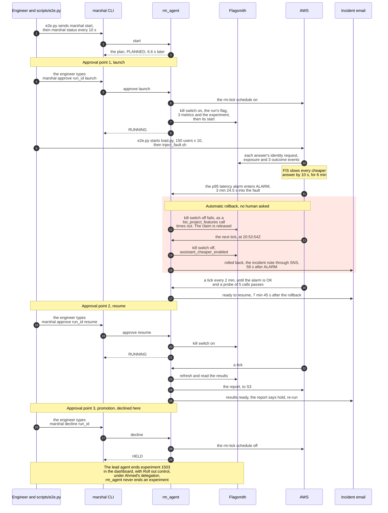
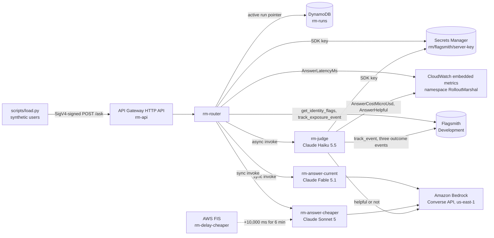
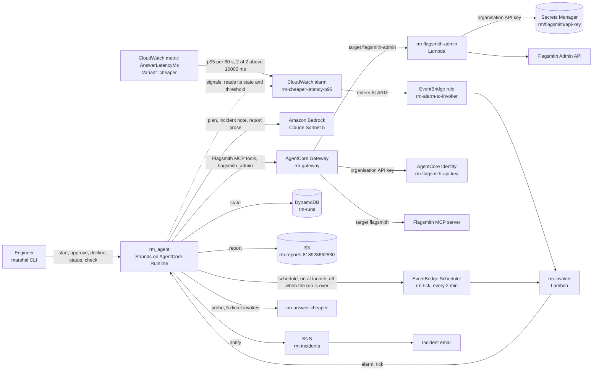
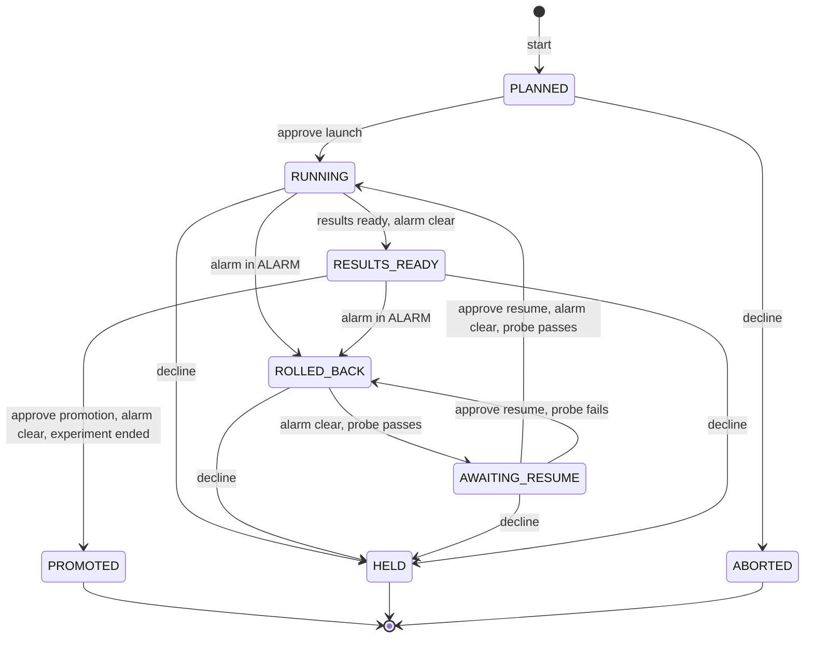

<!-- Draft (task 6.2). The one remaining placeholder, [[6.4: video URL]], is Ahmed's, after he
records. Delete this comment once it is filled. -->

# Rollout Marshal

**An AI agent that runs a Bedrock model migration as a Flagsmith experiment from one prompt,
rolls back on its own, and asks a human before every other change.**

- **One prompt, one plan.** `marshal start` turns a plain request into a hypothesis, a primary
  metric, guardrails, a 50/50 split and stop rules. Nothing exists in Flagsmith until the
  engineer approves.
- **It builds and runs the experiment.** The run's flag, its `cheaper` variation and the
  experiment go through Flagsmith's MCP server. The three metrics, the start and the results go
  through Flagsmith's Admin API.
- **It rolls back without asking.** When the p95 latency alarm on the cheaper arm fires, it
  turns a kill switch off, so every user gets the current model, and sends an incident note.
  Every run is a test: 150 synthetic users send the traffic, and AWS Fault Injection Service
  slows the cheaper model's answers on purpose ([What is simulated](#what-is-simulated)). In
  the two full runs, the rollback came 26 s and 58 s after the alarm.
- **A human approves the rest.** Launch, resume and promotion each wait for `marshal approve`;
  the rollback is the only change to live traffic it makes without asking. The report's
  recommendation comes from fixed rules, and the agent never ends an experiment.

Built by team Built Not Theorized for the Toggle Wars hackathon (Flagsmith and WeMakeDevs),
Track 2, "AI Agents and Feature Flags". Demo video: [[6.4: video URL]]. The video records one
new short run, 150 users x 2 questions, screen-recorded as it ran. The two full runs below are
the measured record.

**Who is who.** Ahmed is the human on the team, and plays the engineer. "The lead agent" is the
AI coding agent, a Claude Code session, that led this build and ran both full runs; it is not
`rm_agent`, the agent this project builds. Who typed or clicked what comes from the lead
agent's account, from its session log, and this README says where the lead agent stood in for a
person.

**Contents:** [The numbers](#the-numbers) · [The problem](#the-problem) ·
[What a run looks like](#what-a-run-looks-like) ·
[The three approval points](#the-three-approval-points) · [Safety rails](#safety-rails) ·
[Architecture](#architecture) · [How Flagsmith is used](#how-flagsmith-is-used) ·
[How the decision is made](#how-the-decision-is-made) ·
[The two full runs](#the-two-full-runs) · [What is simulated](#what-is-simulated) ·
[Known biases](#known-biases) · [Limitations](#limitations) · [Set it up](#set-it-up) ·
[Repository layout](#repository-layout) · [More](#more)

## The numbers

From the two full runs, `r202611271927` and `r202611272042`, both on 2026-11-27:

| | First run | Second run |
| --- | --- | --- |
| The alarm, after the fault started | 3 min 27 s | 3 min 24.5 s |
| The rollback, after the alarm, with no human | 26 s | 58 s |
| Rollout Marshal's own setup, with 3 metrics attached | about 1 min 20 s | about 39 s |
| The plan waiting for the engineer's approval | 12 min 33 s | 6 min 43 s |
| `marshal start` to `RUNNING`, in all | 13 min 53 s | 7 min 22 s |
| Commands the engineer typed (by the lead agent's account) | 3 | 3 |

One pass through Flagsmith's dashboard set up the same experiment in about 2 min 18 s, with one
metric attached.

- **The dashboard pass was an AI agent's.** The lead agent, not a person, clicked it through
  in Chrome, at Ahmed's instruction by the lead agent's account. Its time includes that agent's
  own pauses between actions, so a person might be faster or slower. The dashboard's experiment
  form attaches one metric, the primary.
- **The human's wait is shown apart.** Rollout Marshal's own work is the time on either side
  of it: 7.6 s to plan and 72.9 s to launch in the first run, whose first experiment start
  timed out and was retried by the next tick (the `rm-tick` schedule wakes the agent every 2
  minutes); 6.6 s and 32.7 s in the second. Where the wait ends comes from `scripts/e2e.py`'s
  status polls, every 10 s, so up to about 10 s of each launch counts in the wait. By the
  runtime's log, the launches took 77.5 s and 37.9 s.
- **What the runs showed.** Flagsmith's dashboard favoured the cheaper model both times, at 66
  and 80 percent winner probability. Rollout Marshal's report said `hold, re-run`, because each
  run had an incident. The rollback, not Flagsmith, skewed the dashboard's sample: Claude
  Sonnet 5 served only 153 of the cheaper arm's 740 answers in the first run, and 256 of 690 in
  the second. The current model served the rest while the kill switch was off.

How each was measured, and what neither number counts: [docs/time-saved.md](docs/time-saved.md).

## The problem

Moving a production assistant to a cheaper model is a real cost decision that teams make by
hand today: set up flags, wire metrics, watch dashboards, decide in a meeting.

The move tested here takes a support assistant from Claude Fable 5.1 to Claude Sonnet 5 on
Amazon Bedrock. Per token, Claude Sonnet 5's list price in us-east-1 is a fifth of Claude
Fable 5.1's, for input and for output. The prices are in [app/prices.json](app/prices.json),
copied from the Bedrock pricing page's price files on 2026-11-27
([evidence/3.3-prices.md](evidence/3.3-prices.md)). The question is whether its answers stay
as helpful, and as fast.

Testing that safely takes a new flag and a new experiment for every run, metrics wired to each
answer's outcome, someone watching latency the whole time, a fast rollback when the cheaper
model misbehaves, and a decision at the end that someone can defend. Rollout Marshal runs that
loop from one prompt.

## What a run looks like

Run `r202611272042` went from `marshal start` to `HELD` in 22 min 37 s. `scripts/e2e.py` drove
it: it sent the start, read the run's status every 10 s, and started the load and the fault. By
the lead agent's account, Ahmed typed the three commands at the approval points. In the
diagram, AWS is the assistant (`rm-router` and `rm-judge`), FIS, the alarm, the `rm-tick`
schedule with `rm-invoker`, and S3.



The rollback took the release-and-resume path. The alarm's own invocation failed on a Flagsmith
timeout and released its claim, and the next tick did the whole rollback, 58 s after the alarm
([What the runs found](#what-the-runs-found)).

Step by step:

1. **The ask.** `marshal start "<prompt>"` returns a plan: a hypothesis, the primary metric,
   guardrails, a 50/50 split and stop rules. Nothing exists in Flagsmith for the run yet.
2. **Approve the launch.** `marshal approve <run_id> launch`. The agent turns the kill switch
   on, creates the run's feature, its `cheaper` option and the experiment in Flagsmith, with
   the three metrics it gets or creates, and starts it.
3. **Traffic.** `scripts/load.py` sends 150 synthetic users, 10 questions each, to the
   assistant API. Each user is served the model Flagsmith assigns it.
4. **A failure.** `scripts/inject_fault.sh` makes every answer from the cheaper model 10
   seconds slower, for 6 minutes. The p95 latency alarm on the cheaper arm fires.
5. **Automatic rollback.** Without asking anyone, the agent turns the kill switch
   `assistant_cheaper_enabled` off, so every user gets the current model. It sends an incident
   note to SNS topic `rm-incidents`, which has one email subscription.
6. **Resume, with a human.** Once the alarm has cleared and a health probe of 5 calls passes,
   the agent sends a resume request. `marshal approve <run_id> resume` checks both again and
   turns the kill switch back on.
7. **The report.** When each arm has at least 50 identities and Flagsmith's results are in, the
   agent writes a report to S3 and sends it, with a recommendation made by fixed rules.
8. **The decision.** To hold: `marshal decline <run_id>`, then end the experiment in the
   Flagsmith dashboard with "Roll out control", since a hold leaves it running. To promote: end
   the experiment in the dashboard, choosing "Roll out a variant: cheaper", then
   `marshal approve <run_id> promotion`, which sets `assistant_default_model` to `cheaper` for
   everyone. No run has been promoted
   ([The three approval points](#the-three-approval-points)).

The plan, as `marshal start` printed it in that run
([evidence/5.2/e2e-log.txt](evidence/5.2/e2e-log.txt)). The model wrote the summary after
"Planned run" and the hypothesis; code wrote every other line:

```text
run:      r202611272042
state:    PLANNED
message:  Planned run r202611272042: We'll run a 50/50 split experiment between Claude Fable 5.1 (current) and Claude Sonnet 5 (cheaper), with helpful_rate as the primary metric and mean_latency_ms and mean_cost_micro_usd tracked as guardrails. Results will be considered valid once each variation reaches at least 50 identities. If the rm-cheaper-latency-p95 alarm triggers, Claude Sonnet 5 will be automatically rolled back without requiring approval. No promotion will happen automatically — the experiment will continue until you end it and approve the outcome.
Hypothesis: Claude Sonnet 5 will achieve a helpful_rate at least as high as Claude Fable 5.1 without breaching the mean_latency_ms or mean_cost_micro_usd guardrails.
Split: 50 percent current (us.anthropic.claude-fable-5-1), 50 percent cheaper (us.anthropic.claude-sonnet-5).
Primary metric: helpful_rate. Guardrails: the cheaper arm's mean_latency_ms at most 110 percent of the current arm's, and its mean_cost_micro_usd at most 100 percent of it.
Floor: at least 50 identities per variation, and no results are read in the first 600 seconds.
Alarm: rm-cheaper-latency-p95 rolls the run back without asking.
Rule: any incident means hold, re-run; otherwise promote only if the lower bound of Flagsmith's 95 percent credible interval for the lift on helpful_rate is at or above -5 percent and both guardrails pass; otherwise hold. Promotion also waits for the experiment to be ended in Flagsmith, and for your approve.
Approve with `marshal approve r202611272042 launch`, or decline with `marshal decline r202611272042`.
awaiting: launch
```

The report's recommendation, as written to S3
([evidence/5.2/report-r202611272042.md](evidence/5.2/report-r202611272042.md)). Code wrote
these lines; a paragraph of the model's prose follows them in the report:

```markdown
## Recommendation

**hold, re-run**

The rule, applied in code: any incident means hold, re-run. Otherwise promote only if there is at least a 97.5 percent probability that the lift on `helpful_rate` is at least -5 percent (the lower bound of the 95 percent credible interval at or above -5 percent) and both guardrails pass; otherwise hold. Promotion still waits for the engineer to end the experiment in Flagsmith and approve.

Rolled-back users still count in the cheaper arm, so this comparison is biased: re-run it without an incident.
```

## The three approval points

The engineer approves three steps, each by name. The only change to live traffic the agent
makes alone is the rollback.

| Command | The agent asks for it | What happens on approve |
| --- | --- | --- |
| `marshal approve <run_id> launch` | after `marshal start`, while the run is `PLANNED` | It sets up the experiment in Flagsmith and starts it |
| `marshal approve <run_id> resume` | after a rollback, once the alarm is out of ALARM and the probe has passed: the run is `AWAITING_RESUME` | It checks the alarm and probes again, then turns the kill switch back on. If the alarm is in ALARM again, it answers "Not now" and changes nothing; if the probe fails, the run goes back to `ROLLED_BACK` |
| `marshal approve <run_id> promotion` | after the report, while the run is `RESULTS_READY` | Only once the experiment is ended in Flagsmith, it sets `assistant_default_model` to `cheaper`; before that, it is refused with `EXPERIMENT_NOT_ENDED`. If the alarm is in ALARM, it rolls back instead |

- **No run has been promoted.** The promotion transition and its `EXPERIMENT_NOT_ENDED` guard
  are covered by unit tests, in `agent/tests/test_handlers.py`. Its Flagsmith write is a v2
  feature version, as the kill switch's is. Task 2.2's live test covered that write on a
  scratch feature: it set `spike_default_model` to `cheaper` and back
  (`agent/tests/test_flagsmith_tools.py`, [evidence/2.2-live.md](evidence/2.2-live.md)).
- **An approve names its step.** If the run now waits for something else (an alarm moved it,
  say), the approve is refused with `ILLEGAL_IN_STATE` and nothing changes.
- **What an approve proves.** It is a `marshal` call made with AWS credentials that may invoke
  the agent. Rollout Marshal checks the run's state and the step's name, not who typed the
  command, and the run's history records `engineer` for every CLI call.
- **`marshal decline <run_id>`** stops a run at any point before it ends: `ABORTED` before the
  launch, `HELD` after it.
- **`marshal status [run_id]`** shows a run. **`marshal check <run_id>`** does now what the
  alarm or the next tick would do: the manual fallback if the alarm path breaks.

## Safety rails

Beyond the three approvals, four rules hold for every run:

- **Rollout Marshal never ends an experiment.** Ending one is a click in the Flagsmith
  dashboard, outside Rollout Marshal, and promotion waits for it. In the two full runs the lead
  agent clicked it, under Ahmed's delegation ([Who did what](#who-did-what)). `rm_agent`'s tools
  cannot do it ([How Flagsmith is used](#how-flagsmith-is-used)).
- **One run at a time.** `marshal start` is refused with `RUN_ACTIVE` while a run is active.
- **Secrets stay in Secrets Manager and AgentCore Identity.** They are read at run time and
  never printed.
- **The load is bounded.** `scripts/load.py` stops at its count, refuses to start while
  another load runs, and signs every request; the API accepts only IAM-signed requests.

## Architecture

There are two halves: the assistant under test, which serves each answer, and `rm_agent`, which
runs the experiment on it. Everything on AWS runs in one account, in us-east-1. Flagsmith is the
SaaS, project "Toggle Wars", environment "Development".

### The system under test



`rm-router`, `rm-judge` and the two answer functions are Lambda functions. The three models
run on Amazon Bedrock, through its Converse API. For each answer, `rm-router`:

1. reads the active run's pointer from DynamoDB `rm-runs`, cached for 30 seconds;
2. makes one Flagsmith identity request, `get_identity_flags`, whose result carries both the
   run's experiment feature and the kill switch;
3. records the exposure, for an identity in the experiment;
4. serves `current` when the kill switch is off, and the assigned model otherwise;
5. times the answer invoke, so an injected delay shows in `AnswerLatencyMs`;
6. hands the answer to `rm-judge`, off the request path.

`rm-judge` asks Claude Haiku 5.5 whether the answer is helpful, computes its cost from the
token counts and `app/prices.json`, and writes both to CloudWatch. Then it sends three events
to Flagsmith for the same identity: `answer_helpful` (1 or 0), `answer_latency_ms` and
`answer_cost_micro_usd`.

With no active run, the router serves the model `assistant_default_model` names, and records
no exposure and no event.

### The agent and its signals



- `rm_agent` is a Strands agent on Amazon Bedrock AgentCore Runtime, deployed as
  `rm_default_rm_agent`. Each invocation is short and stateless; the run lives in DynamoDB
  `rm-runs`.
- Apart from the arrow to its model, its tools label its arrows: `state`, `report`, `notify`,
  `probe`, `schedule`, `signals` (the dotted arrow, a read of the alarm), the Flagsmith MCP
  tools and `flagsmith_admin`. Both Flagsmith tools reach the Gateway over MCP, signed with
  SigV4.
- Three things wake it: the `marshal` CLI; `rm-invoker` when the alarm enters ALARM; and
  `rm-invoker` again every 2 minutes on the `rm-tick` schedule, which runs only from the launch
  to the end of the run. The CLI and `rm-invoker` find it by the ARN in SSM parameter
  `/rm/agent-runtime-arn`.
- The alarm watches the p95 of `AnswerLatencyMs` for `Variant=cheaper`, over 60-second
  periods, and fires when 2 of 2 are above 10000 ms. That threshold is the cheaper arm's p95 in
  an earlier 300-answer smoke run with no fault, 4772.8 ms, plus half the injected delay,
  rounded up to the next 1000 ms
  ([design.md](openspec/changes/build-rollout-marshal/design.md) section 5).
- Its model, Claude Sonnet 5, does three things only: it turns the prompt into a plan, writes
  the incident note and writes the report's prose. State changes, stop rules and the
  recommendation are deterministic code.
- Each change of state first checks its conditions, then claims the run's item with a
  conditional write, runs its effects, and commits. So it happens at most once, even when an
  alarm and a tick arrive together. If an effect fails, the agent releases its claim, and the
  next tick or `marshal check` finishes the same change.
- The infrastructure is Terraform in `infra/`, except three pieces: the agent runtime, which
  the AgentCore CLI deploys through its own CDK stack; the Gateway pieces, which
  `agent/scripts/setup_gateway.py` creates; and the SSM parameter, which
  `agent/scripts/deploy_agent.py` writes after each deploy.

### A run's states



The terminal states are `PROMOTED`, `HELD` and `ABORTED`. Each transition's trigger, conditions
and effects are in [design.md](openspec/changes/build-rollout-marshal/design.md) section 6.

## How Flagsmith is used

Rollout Marshal uses four parts of Flagsmith: the MCP server, the Admin API, the Python SDK and
Experimentation.

| Part of Flagsmith | Used by | For |
| --- | --- | --- |
| **MCP server** | `rm_agent`, through Gateway target `flagsmith` | the run's feature, its option and its experiment; the kill switch and the default model |
| **Admin API**, through a Lambda | `rm_agent`, through `rm-flagsmith-admin` | the three metrics; the experiment's start, results and status |
| **Admin API**, directly | `scripts/bootstrap_flagsmith.py`, `seed_experiment.py`, `reset.py` | the two permanent features; a test run without the agent; the reset between runs |
| **Python SDK** | `rm-router` and `rm-judge` | one identity request, one exposure and three outcome events per answer |
| **Experimentation** | the experiment, and the dashboard, where it is ended outside Rollout Marshal | the 50/50 split, the three metrics, results per arm, and the end of each experiment |

- **The MCP server**, `https://mcp.flagsmith.com`, with the organisation API key that
  AgentCore Identity holds. The agent may call 11 of its tools: `list_environments`,
  `list_project_features`, `create_feature`, `list_feature_multivariate_options`,
  `create_feature_multivariate_option`, `list_experiments`, `create_experiment`,
  `create_environment_feature_version`, `get_environment_feature_version_states`,
  `update_environment_feature_version_state` and `publish_environment_feature_version`.
  - With them it creates the run's multivariate feature `assistant_model_<run_id>` (value
    `current`) and its option (key and value `cheaper`), then the experiment with its whole
    rollout block: 100 percent of identities, `cheaper` at 50 percent.
  - It turns the kill switch `assistant_cheaper_enabled` off and on, and sets
    `assistant_default_model` on promotion, each through a v2 feature version: create it,
    update its state, publish it.
- **The Admin API**, `https://api.flagsmith.com`, through the five tools of Lambda
  `rm-flagsmith-admin` (Gateway target `flagsmith-admin`): `ensure_metrics`,
  `start_experiment`, `refresh_results`, `get_results` and `get_experiment`. They get or create
  the three metrics, start the experiment, refresh and read its results, and read its status,
  to check it has ended before a promotion.
- **The Python SDK**, `flagsmith` 6.6.0 or later, with remote evaluation and
  `enable_events=True`, without which its `track_event` raises an error. Per answer: one
  `get_identity_flags`; `track_exposure_event` for an identity in the experiment; three
  outcome events through `track_event`; `flush_events()` before every return.
- **Experimentation.** Three metrics, `helpful_rate` attached first as the primary, and
  `mean_latency_ms` and `mean_cost_micro_usd` as guardrails; results per arm, with the lift
  and its 95 percent credible interval.
- **Why both MCP and the Admin API.** The MCP server has no tool to start an experiment or to
  refresh results, and its `create_metric` drops the required definition, as an early spike
  found ([evidence/1.3-flagsmith-agent-spike.md](evidence/1.3-flagsmith-agent-spike.md)). Its
  experiment tools take a status field, which the agent never sends. So those three go
  through the Admin API.
- **The join.** The judge's outcome events, sent from a second SDK client in another
  invocation, join the router's exposures per identity. An early spike showed it on a test
  experiment ([evidence/1.4-spike-experiment.md](evidence/1.4-spike-experiment.md)).
- **The budget.** One identity request per answer, against the Free plan's 50,000 API
  requests a month. In a run, each answer also sends an exposure and three outcome events.
  Flagsmith's docs do not list event calls as billable; this was not observed
  ([design.md](openspec/changes/build-rollout-marshal/design.md) section 13).
- **What the agent never does in Flagsmith:** end, pause or roll out an experiment, or change
  an experiment's feature while it runs. At the tool boundary, its MCP allow-list above leaves
  out `update_experiment` and every delete tool, an experiment create that carries a status
  field is refused, and its Admin API path builder cannot produce `complete/`, `pause/` or
  `rollout/`.
- **The primary metric.** The API has no primary-metric field, so the agent attaches
  `helpful_rate` first. In both full runs the dashboard showed `helpful_rate`, "should not
  decrease", as primary.

## How the decision is made

Fixed rules in code turn Flagsmith's results into the recommendation; the model writes only
the report's prose.

- **The metrics.** The primary metric is `helpful_rate`, the mean of `answer_helpful` (1 or
  0). The guardrails: the cheaper arm's `mean_latency_ms` is at most 110 percent of the
  current arm's, and its `mean_cost_micro_usd` is no higher.
- **When results count.** They are ready when both arms have at least 50 identities and all
  three metrics have values. They are not read in the first 600 seconds after the launch, so a
  fast-filling experiment cannot finish before a fault can show.
- **The rule:**
  - any incident during the run: `hold, re-run`;
  - otherwise `promote`, only if the lower bound of Flagsmith's 95 percent credible interval
    for the relative lift on `helpful_rate` is at or above minus 5 percent (-0.05) and both
    guardrails pass. That is at least a 97.5 percent probability that the lift is at least
    minus 5 percent;
  - otherwise `hold`.
- **What to expect.** No run has recommended `promote`. Every planned run injects the fault,
  so the rule says `hold, re-run` after each one, as it did in both full runs.

Each report is at `s3://rm-reports-818928662830/runs/<run_id>/report.md`, with nine sections:
Hypothesis, Setup, Timeline, Results, Guardrails, Incident, Known bias, Recommendation and Time
taken. The bucket blocks public access, so the two full runs' reports are attached as written
to S3: [evidence/5.1/report-r202611271927.md](evidence/5.1/report-r202611271927.md) and
[evidence/5.2/report-r202611272042.md](evidence/5.2/report-r202611272042.md).

## The two full runs

Both full runs ran on 2026-11-27, rolled back on the injected fault with no human involved,
and ended `HELD`. Each had the history `PLANNED`, `RUNNING`, `ROLLED_BACK`, `AWAITING_RESUME`,
`RUNNING`, `RESULTS_READY`, `HELD`, and no code changed between them. The records are
[evidence/5.1-e2e.md](evidence/5.1-e2e.md) and
[evidence/5.2/r202611272042.md](evidence/5.2/r202611272042.md).

| | First, `r202611271927` | Second, `r202611272042` |
| --- | --- | --- |
| `marshal start` | 19:26:55Z | 20:42:29Z |
| Fault started | 19:40:50Z | 20:49:52Z |
| Alarm in ALARM | 19:44:17Z | 20:53:17Z |
| Rolled back, no human | 19:44:43Z, 3 min 53 s into the fault | 20:54:15Z, 4 min 22.6 s into the fault, finished by the next tick |
| Alarm back to OK | 19:51:17Z | 21:01:17Z |
| Resume request | 29 min 36 s after the rollback, held back by a probe bug fixed mid-run (below) | 7 min 45 s after the rollback |
| Resumed, on the engineer's approval | 20:32:52Z | 21:03:00Z |
| Results ready: the report written to S3 and sent | 20:34:39Z | 21:04:20Z |
| `HELD`, on the engineer's decline | 20:35:20Z | 21:05:06Z |
| The load | 1,500 sent, 1,498 answered (two name lookups failed on the lead agent's machine) | 1,500 sent, 1,500 answered |
| `scripts/e2e.py` | drove it to `ROLLED_BACK`; the lead agent finished it with `marshal status` reads | drove it from `start` to `HELD`, and exited 0 |

The two reports, attached as written to S3 under `runs/<run_id>/report.md`, are
[evidence/5.1/report-r202611271927.md](evidence/5.1/report-r202611271927.md) and
[evidence/5.2/report-r202611272042.md](evidence/5.2/report-r202611272042.md). Their results:

| Run | Arm | Identities | `helpful_rate` | `mean_latency_ms` | `mean_cost_micro_usd` |
| --- | --- | --- | --- | --- | --- |
| `r202611271927` | current | 76 | 0.996053 | 5519.33 | 13498.3 |
| | cheaper | 74 | 0.997297 | 6361.33 | 11284.7 |
| `r202611272042` | current | 81 | 0.99369 | 5456.23 | 13561.9 |
| | cheaper | 69 | 0.997101 | 6297.08 | 9887.46 |

- **Recommendation: `hold, re-run`**, both times, because each run had an incident.
- **Latency guardrail: failed** both times. The cheaper arm's latency was 115 percent of the
  current arm's, over the 110 percent limit. The fault drove it.
- **Cost guardrail: passed, but biased.** Rolled-back users count in the cheaper arm although
  they were served the current model. So its mean cost, 11284.7 and 9887.46 micro-USD, is far
  above the roughly 2,700 per answer that Claude Sonnet 5's answers alone averaged in an
  earlier smoke run ([evidence/3.6-app-smoke.md](evidence/3.6-app-smoke.md)).
- **Helpfulness is at its ceiling.** `helpful_rate` is near 1 in both arms of both runs. The
  lower bound of the 95 percent credible interval for its lift was about -0.0045 both times,
  a relative lift of -0.45 percent. That is above the rule's bar of minus 5 percent (-0.05).
  It is not evidence that the two models are equally helpful, and the runs held anyway,
  because each had an incident and the latency guardrail failed.
- **Flagsmith's dashboard pointed the other way**, both times.
  - Its experiment page read "66% Winner Probability Confirmed" in the first run and "80%
    Winner Probability Confirmed" in the second, each with "Consider rolling out cheaper to
    all users". Its "Complete experiment" dialog pre-selected "Roll out a variant: cheaper".
    These page readings are the lead agent's, from the browser.
  - Both banners read samples the rollback skewed ([Known biases](#known-biases)). Claude
    Sonnet 5 served only 153 of the cheaper arm's 740 answers in the first run, and 256 of 690
    in the second; Claude Fable 5.1 served the rest while the kill switch was off. So both
    banners compared mostly Claude Fable 5.1 with itself.
  - Rollout Marshal's report said `hold, re-run`. Each run was held, and the lead agent ended
    each experiment with "Roll out control" to match.

### Who did what

- **The commands.** By the lead agent's account, from its session log, Ahmed typed every
  `marshal approve` and `marshal decline` in both runs. AWS cannot tell who typed a command:
  the role is the same either way, and the run's history records `engineer` for any CLI call.
- **The experiment ends.** The lead agent ended experiments 1495 and 1503 in the dashboard,
  with "Roll out control", under Ahmed's delegation, again by its account. It also did the
  dashboard pass that [The numbers](#the-numbers) times.
- **One refused attempt.** Before the first full run, the lead agent tried once to run
  `marshal approve` itself, on `r202611271018`, a start that never launched. Claude Code's auto
  mode, which screens the commands that agent runs, refused it before anything was sent.

### What the runs found

- **A probe bug.** In the first run, the agent's OpenTelemetry instrumentation added a
  `headers` field to the health probe's request, which `answer_request` refuses. Every probe
  failed until a fix was deployed mid-run
  ([evidence/5.1-probe-otel.md](evidence/5.1-probe-otel.md)). The second run used the fixed
  runtime, and its probe passed on the first tick after the alarm cleared.
- **Two Flagsmith timeouts.** Each one failed an effect. Both times the agent released its
  claim, and the next tick finished the change.
  - In the first run, the launch's `start_experiment` failed with a `TimeoutError`, in a warm
    invoke of `rm-flagsmith-admin`. Most likely one Flagsmith request ran past its 4 s limit;
    that is an inference, since payloads are not logged
    ([evidence/5.1-e2e.md](evidence/5.1-e2e.md), finding 2).
  - In the second, the alarm's rollback effect, `set_kill_switch`, failed on a Flagsmith MCP
    `list_project_features` call that timed out (`ReadTimeout`). The next tick did the whole
    rollback, 58 s after ALARM
    ([evidence/5.2/r202611272042.md](evidence/5.2/r202611272042.md), finding 1).
  - So in the two full runs, two of the four Flagsmith-heavy effects, two launches and two
    rollbacks, needed a tick's retry. Neither cause is settled.
- **Three earlier starts never launched.** `scripts/e2e.py`'s 30-minute wait for the launch
  approval ran out twice (it now takes `--pause-minutes`), then an SSO session expired.

## What is simulated

Every run is a test: its users, its failure and its helpfulness scores are simulated, and its
rollback biases its results.

1. **The users.** 150 synthetic identities per run, `<run_id>-user-001` to
   `<run_id>-user-150`, new to Flagsmith on every run. `scripts/load.py` sends them from the
   engineer's shell: 10 questions each in a full run, 1,500 answers, at most 10 at a time. The
   questions are 30 support questions about a fictional SaaS product
   ([app/questions.json](app/questions.json)). No real user is involved.
2. **The failure.** AWS Fault Injection Service adds 10,000 ms to every invocation of
   `rm-answer-cheaper` for 6 minutes (template `rm-delay-cheaper`). `scripts/inject_fault.sh`
   starts it on purpose, and it ends by itself. Its slow answers stay in the cheaper arm's
   `mean_latency_ms`.
3. **Helpfulness.** A model scores it, not a person: Claude Haiku 5.5 grades each answer
   helpful or not, so neither arm grades itself. A reply that is not `{"helpful": true}` or
   `{"helpful": false}` counts as not helpful.
4. **The rollback's bias.** Every planned run injects the fault and so rolls back, and the
   rollback skews the cheaper arm's results ([Known biases](#known-biases)).

Cost is computed, not billed: each answer's input and output tokens times the list prices in
`app/prices.json`.

The lead agent, not a person, did two of the human steps: the dashboard pass that
[The numbers](#the-numbers) times, and the end of both full runs' experiments
([Who did what](#who-did-what)).

## Known biases

A rollback biases the results in two ways. Each report names both
([design.md](openspec/changes/build-rollout-marshal/design.md) section 10):

1. **Users already in the cheaper arm when the rollback starts.** While
   `assistant_cheaper_enabled` is off, they are served the current model, but their outcomes
   still count as the cheaper arm's.
2. **Users who first arrive during the rollback.** An identity first seen while
   `assistant_cheaper_enabled` is off is still assigned an arm, and when Flagsmith assigns it
   `cheaper`, the router serves it `current`. It is enrolled in `cheaper` without ever being
   served it.

Both pull the cheaper arm's numbers toward the current model's: its cost reads too high, and a
comparison of quality compares the current model partly with itself. Claude Sonnet 5 served
only 153 of the cheaper arm's 740 answers in run `r202611271927`, and 256 of 690 in run
`r202611272042`. This is why the rule says `hold, re-run` after any incident.

## Limitations

- **No run has recommended `promote`, and none has been promoted.** Every planned run injects
  the fault, so the rule says `hold, re-run`. The `promote` branch, the promotion transition
  and its `EXPERIMENT_NOT_ENDED` guard have unit tests only; the promotion's Flagsmith write ran
  live only on a scratch feature, in task 2.2
  ([The three approval points](#the-three-approval-points)).
- **Helpfulness is at its ceiling**, so these runs cannot show whether the two models are
  equally helpful ([The two full runs](#the-two-full-runs)).
- **An approval is not tied to a person**
  ([The three approval points](#the-three-approval-points)).
- **Two Flagsmith timeouts are unexplained**, one in each full run
  ([What the runs found](#what-the-runs-found)).
- **The full runs' incident emails were not checked.** Their records hold an SNS message ID for
  each note, not the emails' arrival.
- **The setup has not been run in one go**, from an empty account or with changed IDs
  ([Set it up](#set-it-up)).

## Set it up

You need an AWS account with Bedrock, a Flagsmith project and a few tools, and the IDs this
repo pins changed to yours. Once you have cloned it (step 1), run every command from the
repository root, with AWS credentials for your account in the shell, for example
`export AWS_PROFILE=<your profile>`. Exported access keys override `AWS_PROFILE`, so unset them
first.

### What you need

- **AWS.** An account with Bedrock access, in us-east-1, to `us.anthropic.claude-fable-5-1`,
  `us.anthropic.claude-sonnet-5` and `us.anthropic.claude-haiku-5-5`. Claude Fable 5.1 needs
  the account's Bedrock data retention mode set to `aws_review` in us-east-1. At least 50
  Lambda concurrent executions.
- **Flagsmith.** A project with an environment named "Development", which the agent finds by
  name, whose managed warehouse is connected (Environment Settings, Warehouse) and that uses
  v2 feature versioning, as the code assumes. An organisation API key, and the environment's
  client-side SDK key from its SDK Keys page. This project runs on the Free plan (50,000 API
  requests a month).
- **Tools.** Python 3.13 and uv; Terraform 1.10 or later; the AWS CLI; Node.js and the
  AgentCore CLI (`npm install -g @aws/agentcore@1`, 1.3.0 or later within 1.x); jq.
  `make preflight` checks Terraform, uv, Node.js, jq and the AgentCore CLI, and runs its other
  checks through the AWS CLI.
- **Money.** One full run's 1,500 answers cost about US$17.55: run `r202611272042`'s, from
  CloudWatch's sums of `AnswerCostMicroUsd` before and after it
  ([evidence/5.1-e2e.md](evidence/5.1-e2e.md),
  [evidence/5.2/r202611272042.md](evidence/5.2/r202611272042.md)). On average an answer cost
  13,531.3 micro-USD on Claude Fable 5.1 and 2,708.5 on Claude Sonnet 5 (US$0.0135 and
  US$0.0027). By the end of the second full run, this build's answers came to US$40.81, for
  3,601 answers sent; the video's short run sends 300 more. Judging and the agent's own calls
  come on top.

### The IDs this repo pins

It was built for one AWS account and one Flagsmith project, and its account checks refuse any
other AWS account:

| What | Here | Every file that names it |
| --- | --- | --- |
| AWS account | `818928662830` | `git grep -l 818928662830` |
| Flagsmith organisation | `41656` | `git grep -lw 41656` |
| Flagsmith project | `55601` | `git grep -lw 55601` |

The region stays us-east-1. The files include the Terraform provider's `allowed_account_ids`
(`infra/main.tf`), the state bucket (`infra/backend.tf`), `contracts/names.py` and
[design.md](openspec/changes/build-rollout-marshal/design.md) section 2. The unit tests check
these IDs against design.md and against requests the build recorded in `evidence/`, so change
every file the commands list, not only `contracts/names.py`. Then run `make names-json`, which
regenerates the `contracts/names.json` that Terraform reads. One listed file,
`agent/agentcore/.cli/deployed-state.json`, is the record the AgentCore CLI wrote of this
build's own deployed stack
([evidence/1.3-flagsmith-agent-spike.md](evidence/1.3-flagsmith-agent-spike.md), step 2).
Deploying with changed IDs has not been tried.

### 1. Install and test

```sh
git clone https://github.com/abebars/rollout-marshal
cd rollout-marshal
make install
make test
```

`make install` runs `uv sync`, which creates `.venv` with Python 3.13 and every dependency
group. `make test` runs the unit tests; tests marked `live`, which call AWS and Flagsmith, are
left out.

After any change to `agent/runtime/uv.lock`, also run:

```sh
make test-runtime
```

It runs `agent/tests/test_untraced_invokes.py` against the agent runtime's own pinned
dependencies. Two of its tests run the OpenTelemetry instrumentation the runtime ships, the code
that broke the first run's probe; `make test` skips those two.

### 2. Secrets

Two secrets go in Secrets Manager, in us-east-1. Pasting each value at the prompt keeps it out
of shell history:

```sh
read -s V && aws secretsmanager create-secret --region us-east-1 \
  --name rm/flagsmith/api-key --secret-string "$V"; unset V
read -s V && aws secretsmanager create-secret --region us-east-1 \
  --name rm/flagsmith/server-key --secret-string "$V"; unset V
```

- **`rm/flagsmith/api-key`** holds the organisation API key. Create it on Flagsmith's
  Organisation Settings page: click the organisation's name, open its API keys tab, then
  Create API Key
  ([Flagsmith docs](https://docs.flagsmith.com/integrating-with-flagsmith/flagsmith-api-overview/admin-api/authentication)).
- **`rm/flagsmith/server-key`** holds the environment's client-side SDK key, from its SDK Keys
  page, not a server-side key. The name says what it is for: the key the server code's SDK
  starts with. Remote evaluation and events both work with the client-side key, so no
  server-side key is needed
  ([design.md](openspec/changes/build-rollout-marshal/design.md) section 8).

Each reader fetches its value at run time, and nothing prints it.

### 3. Preflight

```sh
make preflight
```

**Preflight can change an account setting.** If the Bedrock data retention mode in us-east-1
is anything but `aws_review`, it sets it to `aws_review`, the mode for models that need AWS
automated or human review, such as Claude Fable 5.1. It is set at the account level for the
Region, so it applies to the account's Bedrock requests in us-east-1
([Amazon Bedrock data retention](https://docs.aws.amazon.com/bedrock/latest/userguide/data-retention.html)).

It prints one `ok` or `FAIL` line per check: the UTC time; the account; the data retention
mode; both secrets, by their metadata only; one Bedrock Converse call per model; the AgentCore
and FIS APIs; Lambda concurrency; and the tools. If any check fails, `scripts/preflight.sh`
exits 1 (make then reports `Error 1`), but no later step reads its result. Its `gh` line checks
push rights on this repository. Without push rights to the repo, the `gh` line is `FAIL`, so
preflight exits 1; that line does not block the deploy.

### 4. Deploy

Deploy in this order, since each step needs the one before it:

1. **The Terraform state bucket** that `infra/backend.tf` names, before the first
   `terraform init`. Locking uses an S3 lock file, so no lock table is needed. In us-east-1 the
   create takes no location constraint:

   ```sh
   aws s3api create-bucket --bucket rm-tfstate-<your account ID> --region us-east-1
   ```

2. **The agent runtime.**

   ```sh
   uv run python agent/scripts/deploy_agent.py --plan --record <file>
   uv run python agent/scripts/deploy_agent.py --record <file>
   ```

   With `--plan` it runs its checks and the build, and deploys nothing; without it, it
   deploys. Either way it writes its record to `<file>`, as JSON. Without `--plan`, it stops if
   `agent/runtime/`, `contracts/`, `agent/agentcore/agentcore.json` or
   `agent/agentcore/cdk/lib/` has uncommitted changes, so that the commit names what ships:
   commit your ID changes first. With `--plan`, it only records them.

   The script wraps the AgentCore CLI's deploy, which deploys `rm_agent` as
   `rm_default_rm_agent` through its own CDK stack, `AgentCore-rm-default`, and bootstraps CDK
   on the first deploy. It then writes the runtime's ARN to SSM parameter
   `/rm/agent-runtime-arn`, where the CLI and `rm-invoker` read it. On its first deploy here,
   the CLI also turned on CloudWatch Transaction Search for the whole account
   ([evidence/1.3-flagsmith-agent-spike.md](evidence/1.3-flagsmith-agent-spike.md), step 2).
3. **Everything else on AWS**, with Terraform. First copy
   [infra/terraform.tfvars.example](infra/terraform.tfvars.example) to the git-ignored
   `infra/terraform.tfvars`, with `cp infra/terraform.tfvars.example infra/terraform.tfvars`.
   In the copy, set `incident_email` to your address and `invoker_stub = false`. With `true`,
   `rm-invoker` only logs what it would send. Then:

   ```sh
   make build
   terraform -chdir=infra init
   terraform -chdir=infra plan
   terraform -chdir=infra apply
   ```

4. **The Gateway**: its credential provider, its service role, the Gateway and its two
   targets.

   ```sh
   uv run python agent/scripts/setup_gateway.py --plan
   uv run python agent/scripts/setup_gateway.py
   ```

   With `--plan` it only reads, and reports what it would create. Without it, it gets or
   creates each piece by name, so it is safe to repeat.

5. **Flagsmith's two permanent features**, `assistant_cheaper_enabled` (the kill switch) and
   `assistant_default_model` (`current` until a promotion):

   ```sh
   uv run python scripts/bootstrap_flagsmith.py
   ```

6. **The email subscription.** Confirm it from the message SNS sends to `incident_email`.
7. **The check.** `uv run marshal status` prints a message that starts "no active run".

This order follows design.md sections 2 and 7. Nobody has run it in one go from an empty
account: here the pieces went up across several tasks, the agent's in
[evidence/1.3-flagsmith-agent-spike.md](evidence/1.3-flagsmith-agent-spike.md) and
[evidence/2.7-agent-deploy.md](evidence/2.7-agent-deploy.md).

### 5. Run an experiment

Both full runs used the driver:

```sh
uv run python scripts/reset.py
uv run python scripts/e2e.py --pause-minutes 180 --record <new file>.json
```

- `scripts/e2e.py` first checks the account, the alarm, `rm-invoker`'s `STUB`, the FIS
  template, the route and the load lock, and refuses if one fails.
- It sends `start`, then pauses at each approval point and prints the exact command to type in
  a second shell. It never approves anything itself.
- Its pauses wait 30 minutes for the launch, 30 for the resume and 60 for the decision.
  `--pause-minutes 180` lets each wait up to 180 minutes instead.
- Once the run is `RUNNING`, it starts the load and the fault. At the end it prints the run's
  history, its timestamps and its SNS message IDs, and writes them to the `--record` file.

The same steps by hand, in two shells, with the prompt `scripts/e2e.py` sends:

```sh
# First shell: the resting state, then the plan and its launch
uv run python scripts/reset.py
uv run marshal start "Test moving the support assistant from Claude Fable 5.1 to Claude Sonnet 5."
uv run marshal approve <run_id> launch

# Once marshal status shows RUNNING: the load, which runs until it has sent all 1,500 requests
ASK_URL=$(terraform -chdir=infra output -raw ask_url)
uv run python scripts/load.py --run-id <run_id> --users 150 --questions 10 --url "$ASK_URL"

# Second shell, straight after the load starts: the fault, which ends by itself after 6 minutes
scripts/inject_fault.sh
uv run marshal status <run_id>

# After the ready-to-resume note
uv run marshal approve <run_id> resume

# After the results-ready note, which carries the report: either hold, then end the
# experiment in the Flagsmith dashboard with "Roll out control", since a hold leaves it running
uv run marshal decline <run_id>
# or end the experiment in the Flagsmith dashboard with "Roll out a variant: cheaper", then promote
uv run marshal approve <run_id> promotion
```

- `scripts/reset.py` puts the resting state back: no active run, `rm-tick` off, the kill switch
  on and `assistant_default_model` at `current`. It refuses while a run is still active,
  unless given `--force`, and lists any experiment still running, to be ended in the Flagsmith
  dashboard.
- `marshal start` prints the run's ID on its `run:` line. Every `marshal` command exits 0 when
  the response has no error, 1 when it carries an error code or the call fails, and 2 on a
  usage error.
- `ASK_URL` keeps the assistant API's URL out of logs and evidence: never echo it.
- `scripts/inject_fault.sh` takes no arguments, and needs credentials that may start AWS FIS
  experiments. It never stops the experiment.

### 6. Tear it down

No teardown has been run here yet. The build's own cleanup list, with a find and a remove
command for each piece, is in [evidence/gate-1-review.md](evidence/gate-1-review.md#cleanup-list).
It covers the stacks, the Gateway pieces, the Terraform resources, the state bucket, the
secrets and the two account-wide settings: CloudWatch Transaction Search, and the Bedrock data
retention mode. [evidence/gate-2-review.md](evidence/gate-2-review.md),
[evidence/5.1-e2e.md](evidence/5.1-e2e.md) and
[evidence/5.2/r202611272042.md](evidence/5.2/r202611272042.md) add the runs' Flagsmith objects
and `rm-runs` items. Those lists leave out two steps:

- **Empty the reports bucket first.** Before `terraform destroy`, empty
  `rm-reports-<your account ID>`, which holds each run's report: the destroy fails on a bucket
  that is not empty.
- **Delete the SSM parameter.** `agent/scripts/deploy_agent.py` wrote `/rm/agent-runtime-arn`
  outside Terraform, so the destroy leaves it:
  `aws ssm delete-parameter --region us-east-1 --name /rm/agent-runtime-arn`.

[docs/submission.md](docs/submission.md), under "After judging: cleanup", lists both for this
build, with the Flagsmith objects of the video's run.

## Repository layout

Each part of the system has its own directory (design.md section 12):

| Path | Holds |
| --- | --- |
| `agent/` | the agent (`agent/runtime/rm_agent/`), the `rm-flagsmith-admin` function (`agent/flagsmith_admin/`), the deploy and Gateway setup scripts and the AgentCore CLI project |
| `cli/` | the `marshal` command line |
| `app/` | the router, the answer and judge functions, the questions and the prices |
| `signals/` | `rm-invoker` |
| `infra/` | Terraform: the root, and the modules `app`, `agent`, `signals` and `fis` |
| `scripts/` | load, fault, bootstrap, seed, reset, preflight and the end-to-end driver |
| `contracts/` | every shared name (`names.py`) and the JSON schemas |
| `openspec/changes/build-rollout-marshal/` | the proposal, the design (the contract every name comes from), the specs and the task board |
| `evidence/` | what each task ran, with its commands and their output |
| `docs/` | time saved, the video script, the submission checklist and the review protocol |

## More

- How the times were measured: [docs/time-saved.md](docs/time-saved.md)
- The demo video's script: [docs/video-script.md](docs/video-script.md)
- The contract: [design.md](openspec/changes/build-rollout-marshal/design.md)
- The runs: [evidence/5.1-e2e.md](evidence/5.1-e2e.md) and
  [evidence/5.2/r202611272042.md](evidence/5.2/r202611272042.md)
